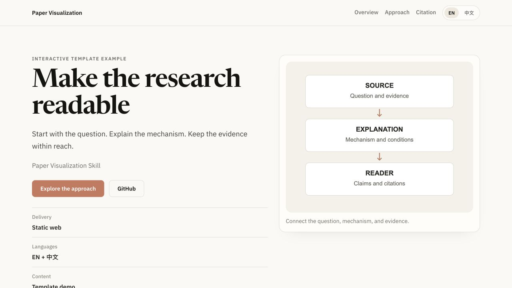

<div align="center">

<h1>Paper Visualization</h1>
<p>Turn a paper into a readable, bilingual research page.</p>
<p><a href="LICENSE"></a></p>
<p><a href="#get-started"><strong>Get started</strong></a> · <a href="docs/guide.md">User guide</a> · <a href="README.zh-CN.md">简体中文</a></p>

</div>

## See the result

[](examples/reading-demo/site/)

A working example generated with the bundled template. It demonstrates layout and language switching, with no invented research findings. Download the repository and serve it locally to try the [English and Chinese example](examples/reading-demo/site/).

## What you can make

| Input | Output |
|---|---|
| A paper PDF, preprint page, or source workspace | A standalone static page that explains the question, method, evidence, and citation |
| Public figures and verified metadata | A visual reading path with links back to the paper |
| English and Chinese content | Separate language routes, shared figures, and page metadata |

Start with a structured JSON config. When a paper needs a different composition, edit the generated HTML, CSS, and JavaScript directly. Publish only the public page and its assets; keep private drafts and authoring sources separate.

## Get started

For a fresh Codex installation:

```bash
git clone https://github.com/DELONG-L/Paper-Visualization-Skill.git
cd Paper-Visualization-Skill
mkdir -p "${CODEX_HOME:-$HOME/.codex}/skills"
cp -R skills/paper-visualization "${CODEX_HOME:-$HOME/.codex}/skills/"
```

If the skill is already installed, preserve local changes before replacing it. Then ask:

```text
Use $paper-visualization to turn this paper into a readable research page.
Use the supplied figures, preserve the claim boundaries, and add Chinese if needed.
```

The scaffold helper requires Python 3. To generate a starter directly:

```bash
python3 skills/paper-visualization/scripts/bootstrap_paper_visualization.py ./my-paper --bilingual
```

Fill the generated configs and add the actual paper assets. See the [user guide](docs/guide.md) for PDF input, metadata, packaging, and alternate directories.

## Try the example

From this repository root:

```bash
python3 -m http.server 8123 --bind 127.0.0.1
```

Open [the English example](http://127.0.0.1:8123/examples/reading-demo/site/) or [the Chinese example](http://127.0.0.1:8123/examples/reading-demo/site/zh/). The example illustrates the template; it is not a scientific publication.

## Learn more

[Skill instructions](skills/paper-visualization/SKILL.md) · [Config schema](skills/paper-visualization/references/config-schema.md) · [Content workflow](skills/paper-visualization/references/workflow.md) · [MIT licence](LICENSE)
