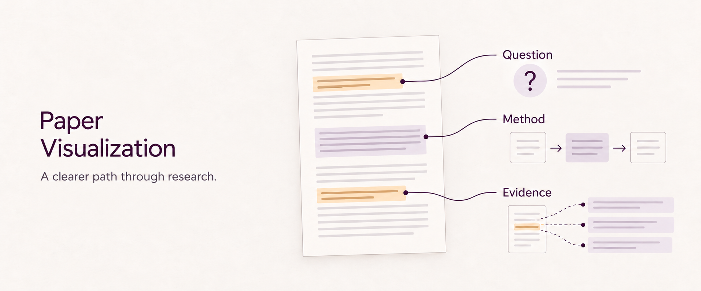
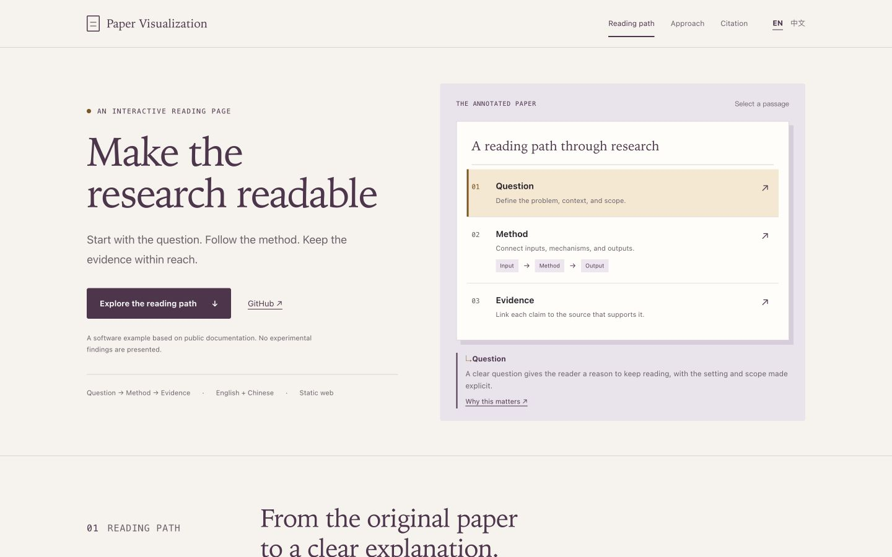

# Paper Visualization

Turn a paper PDF, preprint page, or source workspace into a readable research page, with figures, citations, and optional English and Chinese routes.

**[▶ Explore the interactive example](https://delong-l.github.io/Paper-Visualization-Skill/)** · [Get started](#get-started) · [User guide](docs/guide.md) · [简体中文](README.zh-CN.md)

<a href="#see-the-result"></a>

[](LICENSE)

<a id="see-the-result"></a>
## A reading page you can explore

[](https://delong-l.github.io/Paper-Visualization-Skill/)

Select a passage, follow the reading path, inspect the source notes, and copy the software citation. Switch between English and Chinese editions.

**[▶ Open the English example](https://delong-l.github.io/Paper-Visualization-Skill/)**

This custom static example uses the skill's public documentation as its source. It demonstrates the software workflow and presents no experimental findings.

## From source material to a research page

| Start with | Keep visible |
|---|---|
| A paper PDF, preprint page, or source workspace | The research question, method, evidence, and citation |
| Public figures and verified metadata | The paper's identity and a route back to its sources |
| English and Chinese content | Separate language routes with shared public assets |

Use a structured JSON config to begin. When the paper needs a different composition, adapt the generated HTML, CSS, and JavaScript directly. Keep claim boundaries intact and choose figures that help explain the work.

<a id="get-started"></a>
## Get started

For a **fresh Codex installation**:

```bash
git clone https://github.com/DELONG-L/Paper-Visualization-Skill.git
cd Paper-Visualization-Skill
mkdir -p "${CODEX_HOME:-$HOME/.codex}/skills"
cp -R skills/paper-visualization "${CODEX_HOME:-$HOME/.codex}/skills/"
```

If the skill is already installed, preserve local changes before replacing it. Provide your paper or source directory and ask:

```text
Use $paper-visualization to turn
this paper into a readable
research page. Use the supplied
figures, preserve claim boundaries,
and add Chinese if needed.
```

<details>
<summary><strong>Prefer to generate the scaffold directly?</strong></summary>

The scaffold helper requires Python 3:

```bash
python3 skills/paper-visualization/scripts/bootstrap_paper_visualization.py ./my-paper --bilingual
```

Fill the generated configs and add the actual paper assets. The [user guide](docs/guide.md) covers PDF input, metadata, packaging, and alternate directories.

</details>

## What the skill creates

- **A static research page:** HTML, CSS, JavaScript, local figures, and a paper PDF when supplied.
- **Optional bilingual routes:** `docs/` and `docs/zh/`, with a config for each language.
- **Page metadata:** descriptions, canonical URLs, language alternates, and a generated sitemap.
- **A portable site package:** `release/site-package/`, ready for a static host. Keep private drafts and authoring sources outside the public site directory.

<details>
<summary><strong>Try the example locally</strong></summary>

Download or clone the repository, then run this command from its root:

```bash
python3 -m http.server 8123 --bind 127.0.0.1
```

Open [the English example](http://127.0.0.1:8123/examples/reading-demo/site/) or [the Chinese example](http://127.0.0.1:8123/examples/reading-demo/site/zh/).

</details>

[Skill instructions](skills/paper-visualization/SKILL.md) · [Config schema](skills/paper-visualization/references/config-schema.md) · [Content workflow](skills/paper-visualization/references/workflow.md) · [Example source](examples/reading-demo/site/) · [Visual assets and sources](docs/visuals.md) · [MIT licence](LICENSE)
