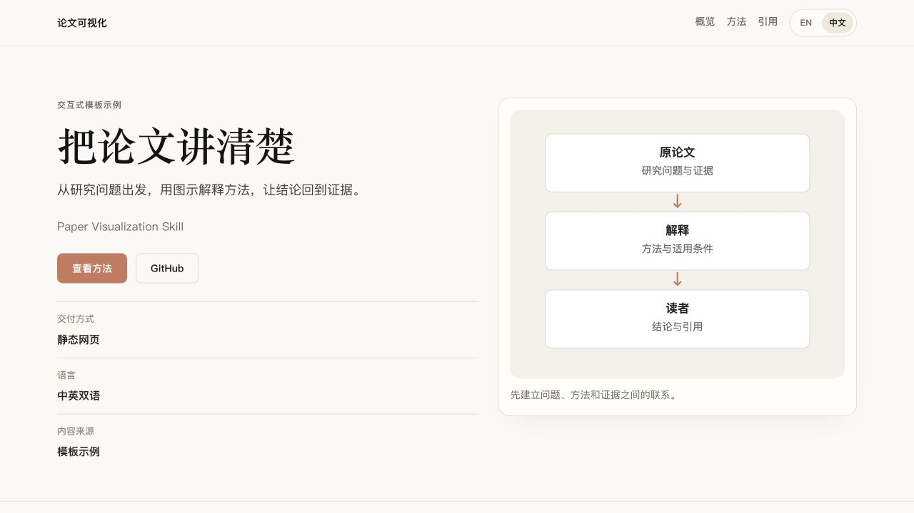

<div align="center">

<h1>Paper Visualization</h1>
<p>把论文整理成清楚、可阅读的中英文研究页面。</p>
<p><a href="LICENSE"></a></p>
<p><a href="#开始使用"><strong>开始使用</strong></a> · <a href="docs/guide.zh-CN.md">使用指南</a> · <a href="README.md">English</a></p>

</div>

## 看看效果

[](examples/reading-demo/site/zh/)

这是用内置模板生成的可运行示例，展示布局和语言切换，不包含虚构的研究结论。下载仓库后，可以在本地打开[中英文示例](examples/reading-demo/site/)。

## 可以制作什么

| 输入 | 输出 |
|---|---|
| 论文 PDF、预印本页面或源码目录 | 介绍研究问题、方法、证据与引用的独立静态页面 |
| 公开图表和已核实的元数据 | 能回到原论文的可视化阅读路径 |
| 中英文内容 | 分开的语言路由、共享图表和页面元数据 |

先用 JSON 配置组织内容。论文需要不同的版式时，可以直接修改生成的 HTML、CSS 和 JavaScript。公开交付只包含网页及公开资源，私有草稿和论文写作源码单独保存。

## 开始使用

首次安装到 Codex：

```bash
git clone https://github.com/DELONG-L/Paper-Visualization-Skill.git
cd Paper-Visualization-Skill
mkdir -p "${CODEX_HOME:-$HOME/.codex}/skills"
cp -R skills/paper-visualization "${CODEX_HOME:-$HOME/.codex}/skills/"
```

如果已经安装，先保留本地修改再替换。然后调用：

```text
用 $paper-visualization 把这篇论文整理成清楚的研究页面。
使用提供的图表，保留结论的适用范围，并按需要添加英文版本。
```

骨架脚本需要 Python 3。也可以直接生成起点：

```bash
python3 skills/paper-visualization/scripts/bootstrap_paper_visualization.py ./my-paper --bilingual
```

填写生成的配置，添加真实论文资源。[使用指南](docs/guide.zh-CN.md)介绍 PDF 输入、元数据、打包和自定义目录。

## 试用示例

在本仓库根目录运行：

```bash
python3 -m http.server 8123 --bind 127.0.0.1
```

打开[英文示例](http://127.0.0.1:8123/examples/reading-demo/site/)或[中文示例](http://127.0.0.1:8123/examples/reading-demo/site/zh/)。示例用于说明模板，不是科学出版物。

## 继续了解

[技能说明](skills/paper-visualization/SKILL.md) · [配置格式](skills/paper-visualization/references/config-schema.md) · [内容工作流](skills/paper-visualization/references/workflow.md) · [MIT 许可证](LICENSE)
