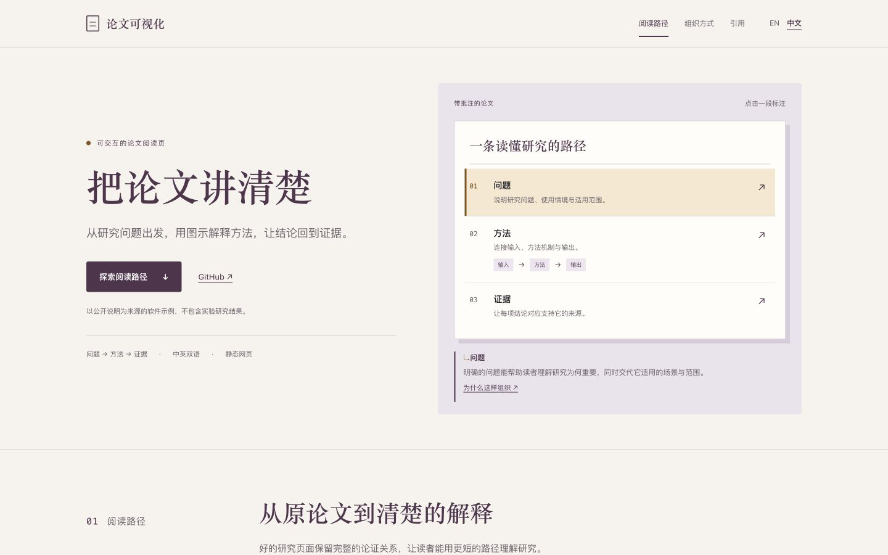

# Paper Visualization

把论文 PDF、预印本页面或源码目录整理成清楚、可阅读的研究页面，呈现图表、引用，并按需要提供中英文路由。

**[▶ 体验互动示例](https://delong-l.github.io/Paper-Visualization-Skill/zh/)** · [开始使用](#get-started) · [使用指南](docs/guide.zh-CN.md) · [English](README.md)

<a href="#see-the-result"></a>

[](LICENSE)

<a id="see-the-result"></a>
## 体验一页论文阅读路径

[](https://delong-l.github.io/Paper-Visualization-Skill/zh/)

点击标注，沿阅读路径理解内容，查看来源说明，并复制软件引用。也可以切换中英文版本。

**[▶ 打开中文示例](https://delong-l.github.io/Paper-Visualization-Skill/zh/)**

这个定制的静态示例以技能公开说明为来源，用于展示软件工作流，不包含实验研究结果。

## 从材料到研究页面

| 来源材料 | 页面内容 |
|---|---|
| 论文 PDF、预印本页面或源码目录 | 研究问题、方法、证据与引用 |
| 公开图表和已核实的元数据 | 论文身份，以及回到原始来源的路径 |
| 中英文内容 | 分开的语言路由，以及共享的公开资源 |

先用 JSON 配置组织内容。论文需要不同版式时，可以直接调整生成的 HTML、CSS 和 JavaScript。保留结论的适用范围，选择有助于解释研究的图表。

<a id="get-started"></a>
## 开始使用

**首次安装到 Codex**：

```bash
git clone https://github.com/DELONG-L/Paper-Visualization-Skill.git
cd Paper-Visualization-Skill
mkdir -p "${CODEX_HOME:-$HOME/.codex}/skills"
cp -R skills/paper-visualization "${CODEX_HOME:-$HOME/.codex}/skills/"
```

已有安装时，先保留本地修改再替换。提供论文或来源目录，再调用：

```text
用 $paper-visualization
把这篇论文整理成清楚的研究页面。
使用提供的图表，保留结论边界，
并按需要提供中英文版本。
```

<details>
<summary><strong>想直接生成页面骨架？</strong></summary>

骨架脚本需要 Python 3：

```bash
python3 skills/paper-visualization/scripts/bootstrap_paper_visualization.py ./my-paper --bilingual
```

填写生成的配置并添加真实论文资源。[使用指南](docs/guide.zh-CN.md)介绍 PDF 输入、元数据、打包和自定义目录。

</details>

## 技能生成什么

- **静态研究页面**：HTML、CSS、JavaScript、本地图表，以及你提供的论文 PDF。
- **可选的双语路由**：`docs/` 与 `docs/zh/`，每种语言分别配置。
- **页面元数据**：描述、规范链接、语言互链，以及生成的站点地图。
- **可迁移的网站包**：`release/site-package/`，可用于静态托管。私有草稿和论文写作源码应放在公开站点目录之外。

<details>
<summary><strong>在本地体验示例</strong></summary>

下载或克隆仓库，在根目录运行：

```bash
python3 -m http.server 8123 --bind 127.0.0.1
```

打开[英文示例](http://127.0.0.1:8123/examples/reading-demo/site/)或[中文示例](http://127.0.0.1:8123/examples/reading-demo/site/zh/)。

</details>

[技能说明](skills/paper-visualization/SKILL.md) · [配置格式](skills/paper-visualization/references/config-schema.md) · [内容工作流](skills/paper-visualization/references/workflow.md) · [示例源码](examples/reading-demo/site/) · [视觉资源与来源](docs/visuals.md) · [MIT 许可证](LICENSE)
